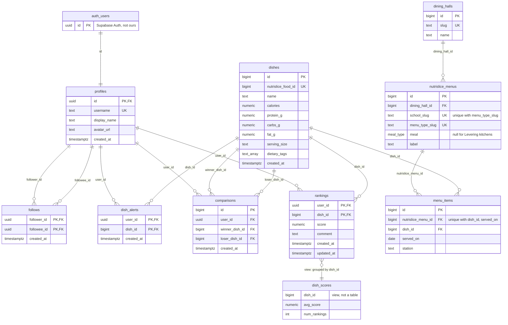

# Schema Diagram

Visual version of [database-schema.md](database-schema.md). Renders on GitHub, or in VS Code with a Mermaid preview extension.

Each line goes from a PK to the FK that references it. `||--o{` means one to many, and `||--||` means one to one.

