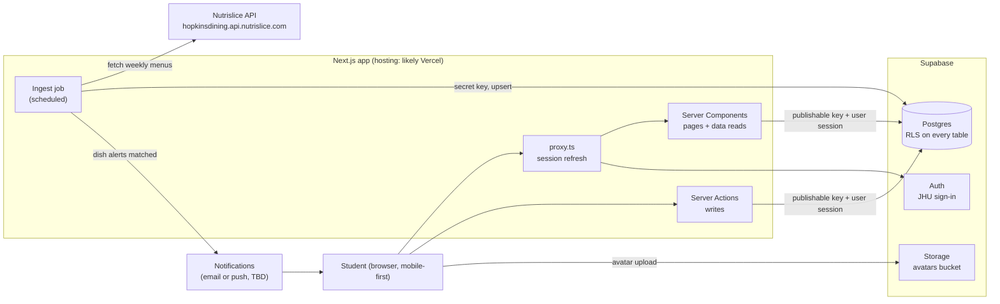

# System Design

High-level view of how Slopkins fits together. Details live in [database-schema.md](database-schema.md) and [ui-refactor.md](ui-refactor.md). Goals and owners: [project-plan.md](project-plan.md).

## Components

| component        | job                                                                      | owner         |
| ---------------- | ------------------------------------------------------------------------ | ------------- |
| Next.js app      | UI, server-side reads, server actions for writes                         | everyone      |
| `proxy.ts`       | refreshes the Supabase session on each request, later redirects to `/`   | Lucas, Amy    |
| Supabase Auth    | JHU sign-in, creates a `profiles` row through a trigger                  | Lucas, Amy    |
| Postgres         | all app data. RLS decides who reads and writes what                      | everyone      |
| Storage          | profile pictures in the `avatars` bucket (not created yet)               | Lucas, Amy    |
| Ingest job       | pulls Nutrislice menus into `dishes` and `menu_items`                    | Kyle          |
| Notifications    | tells users when an alerted dish is on an upcoming menu                  | Kyle          |
| Ranking          | pairwise comparisons into per-user scores and global `dish_scores`       | Jonny         |

## Trust boundaries

- **Browser and server pages** use the publishable key plus the user's session. Postgres RLS is the real access control: users write only their own rows, and dining data is read-only.
- **The ingest job** uses the Supabase secret key, which bypasses RLS. It runs only on the server and is never `NEXT_PUBLIC_`.
- **Nothing trusts the client** for ids, timestamps or ownership. Column grants and RLS enforce it in the database.

## Data flows

### 1. Menu ingest (Kyle)

1. On a schedule, for example nightly plus on demand, loop over `nutrislice_menus`.
2. Fetch `/menu/api/weeks/school/{school_slug}/menu-type/{menu_type_slug}/{yyyy}/{mm}/{dd}/`.
3. Skip section-title rows and rows without `food`. Track the current station from section titles.
4. Upsert `dishes` on `nutrislice_food_id`, then `menu_items` on `(nutrislice_menu_id, dish_id, served_on)`.
5. Join new `menu_items` against `dish_alerts` and hand the matches to notifications.

Scheduler options: a Vercel Cron hitting a protected route handler, or Supabase `pg_cron` calling an Edge Function. Undecided.

### 2. Browse today's menu

`/dining/[slug]` reads `menu_items` for the hall's menus where `served_on` is today in America/New_York, joined to `dishes`, and sorts by `dish_scores.avg_score`. Public data, so it can be cached for hours.

### 3. Log and rank a meal (Kyle, Jonny)

1. The user multi-selects dishes on the hall page and logs a meal (planned `meals` and `meal_dishes` tables).
2. The rank flow asks "X or Y?" for each new dish. Each answer is a `comparisons` row.
3. The score algorithm updates the user's `rankings`. `dish_scores` averages rankings across users.

Today the rank flow saves to localStorage (`features/ranking/store.ts`). Moving to Supabase should only mean rewriting that file.

### 4. Feed and social (Lucas, Amy)

- Follow: insert into `follows` as yourself.
- Feed: posts from people you follow, newest first. No feed table; it's a query over `follows` joined to posts (`meals` or `rankings`). Paginate with a `(created_at, id)` cursor.
- Profile: the user's ranked list from `rankings`, ordered by score.

## Rendering and caching

- **Public dining data:** `'use cache'` with a `cacheLife` of hours. Pass "today" in as an argument so the date is part of the cache key.
- **Per-user data** (feed, my list, profile): uncached, streamed inside `<Suspense>`.
- **Navigation:** `cacheComponents` and `partialPrefetching` give instant navigations. Read URL data and cookies behind `<Suspense>`.

## Scale

Target: JHU meal-plan students, at most a few thousand users. One Supabase project and one Next.js deployment cover it. The things to watch:

- Nutrislice rate limits. Ingest once a day per menu, not per page view.
- The feed query as follows grow. Add a `rankings(updated_at desc)` or `meals(created_at desc)` index if it gets slow.
- Free-tier limits on Supabase and hosting.

## Stretch goals (not designed yet)

- **Local businesses** (Sidechat Sourdough, Claude's Cookies, the chai sellers): a separate `places` model with promotion and orders. Needs their permission first.
- **Busyness and stock alerts:** needs a data source, either crowd-sourced check-ins or the halls themselves.
- **Map view, search, leaderboard and gamification.**

## Open decisions

- Hosting: Vercel or something else.
- JHU sign-in: SSO or SAML, or OAuth restricted to `@jhu.edu`.
- Ingest scheduler: Vercel Cron or Supabase `pg_cron` with an Edge Function.
- Notification channel: email, web push or in-app.
- Feed posts: logged meals, rankings, or both.
